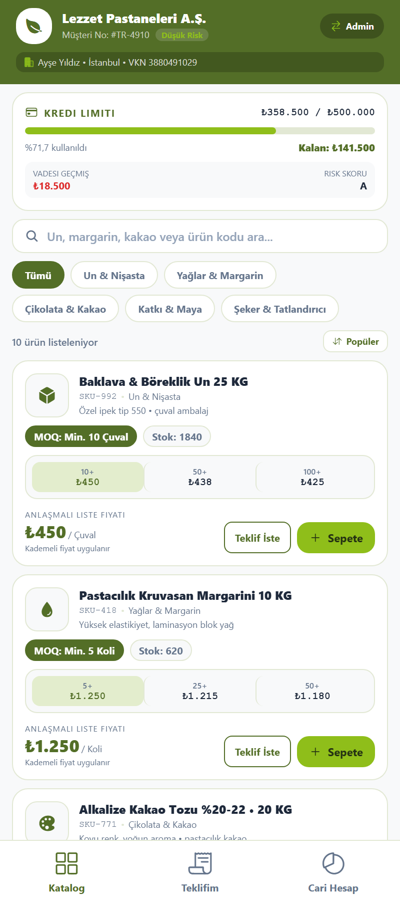
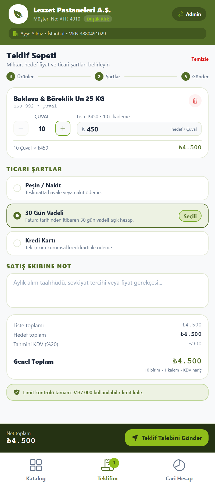
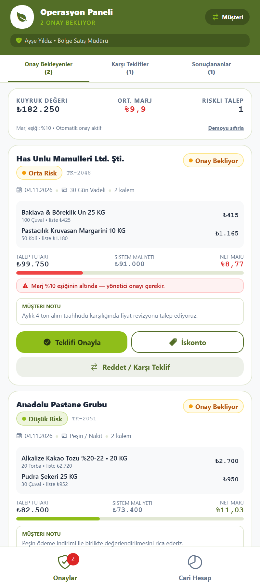
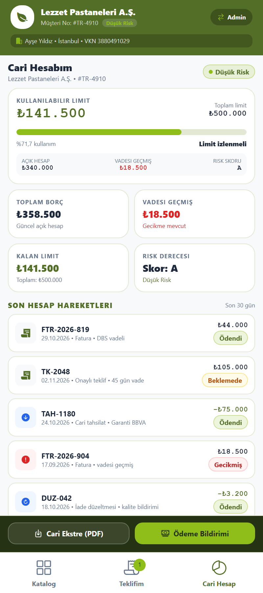

<<<<<<< HEAD
# B2B Toptan Ticaret & Teklif Yönetimi (Expo)

Kurumsal B2B toptan satış firması için **müşteri portalı** ve **çalışan/yönetici onay paneli** içeren, tek kod tabanından iOS, Android ve web'e çıkan mobil uygulama.

Tasarım referansı: Stitch projesi **"B2B Bakery Wholesale App Mockup"** (`projects/903651811949799181`) — pastacılık & fırıncılık toptan ticaret süiti (giriş → katalog → teklif sepeti → pazarlık → admin onay → cari/risk).

| | |
|---|---|
| Stack | Expo SDK 58, React Native 0.88, React 19.3, TypeScript 6 (strict), NativeWind 4.2 (Tailwind 3) |
| Navigasyon | React Navigation 7 — bottom tabs, role'e göre dinamik ağaç |
| Durum | React Context (`AppContext`) + `useMemo` türetilmiş sepet/cari hesapları |
| Backend | Supabase Auth (JWT) + §9 API servis katmanı; yapılandırılmadığında çevrimdışı mock |
| Dil | Türkçe arayüz, ₺ (TRY) para birimi, `tr-TR` sayı biçimi |
| Gereksinim | **Node.js ≥ 22.13 LTS**, en güncel Expo Go (SDK 58) veya development build |

## Ekran görüntüleri

Aşağıdaki kareler uygulamanın gerçek render'ından alındı (web çıktısı, 390×844 viewport, 2× DPR):

| Katalog | Teklif Sepeti |
|---|---|
|  |  |

| Admin Onay Merkezi | Cari Hesap & Risk |
|---|---|
|  |  |

---

## 1. Kurulum

> **Ön koşul:** Node.js **22.13+** (proje Node 20'de Metro'nun renk çıktısında `ERR_INVALID_ARG_VALUE` ile çöker). Bu makinede Node 22.23.4 taşınabilir olarak `%LOCALAPPDATA%\Programs\nodejs22` altına kuruldu ve kullanıcı PATH'ine eklendi — **yeni bir terminal açın**, sonra kontrol edin:
>
> ```powershell
> node -v   # v22.23.4 görmelisiniz
> ```

```bash
node -v                 # >= 22.13 olmalı
npm install
npx expo start          # QR kodu telefonunuzdaki Expo Go ile tarayın
npm run start:lan       # aynı Wi-Fi'daysanız LAN modu
npm run start:tunnel    # güvenlik duvarı/NAT engelliyorsa tünel modu
npm run web             # tarayıcıda çalıştır (telefon gerekmez)
npm run typecheck       # tsc --noEmit
```

> Uygulama varsayılan olarak mock veri ile çalışır. `.env` üzerinden Supabase yapılandırılırsa JWT girişi ve §9 API servis katmanı devreye girer (bkz. **"Supabase + JWT entegrasyonu"**).

---

## 2. Ekranlar ve akış

### Müşteri portalı (`CUSTOMER`)
1. **Katalog** — [`src/screens/CustomerCatalogScreen.tsx`](src/screens/CustomerCatalogScreen.tsx)
   - Kredi limiti banner'ı (limit, açık hesap, vadesi geçmiş, kalan limit, risk skoru).
   - Arama, kategori çipleri (Un, Yağ, Çikolata, Katkı, Şeker), fiyat sıralaması.
   - Ürün kartlarında SKU, açıklama, **MOQ rozeti**, stok, **3 kademeli hacim fiyatı** (aktif kademe vurgulu), liste fiyatı ve birim.
   - Ürün bazlı **"Özel Fiyat Teklifi İste"** modalı: miktar (MOQ sınırlı), hedef birim fiyat, ödeme şekli.
   - Sepette ürün varken alttaki koyu çubuk: kalem/birim sayısı, hedef toplam, "Teklif Sepetine Git".
2. **Teklif Sepeti** — [`src/screens/QuoteBuilderScreen.tsx`](src/screens/QuoteBuilderScreen.tsx)
   - Ürünler → Şartlar → Gönder adım göstergesi.
   - Satır bazında stepper, hedef fiyat girişi, liste fiyatına göre yüzde sapma rozeti, satır toplamı, satır silme.
   - Ticari şartlar: Peşin (%2 iskonto notu), 30 gün vadeli, kredi kartı.
   - Satış ekibine not, liste/hedef toplam, KDV tahmini, genel toplam.
   - **Limit aşımında gönderim engellenir** (buton pasif + kırmızı uyarı + inline hata).
   - Gönderim sonrası sonuç modalı: otomatik onay mı, yönetici onayı mı.
3. **Cari Hesap** — [`src/screens/FinancialLedgerScreen.tsx`](src/screens/FinancialLedgerScreen.tsx)
   - Kullanılabilir limit göstergesi (oransal bar, sağlık durumu), açık hesap / vadesi geçmiş / risk skoru.
   - 4 KPI kartı, hesap hareketleri listesi (fatura, tahsilat, düzeltme; ödendi/beklemede/gecikmiş), dönem özeti.
   - Cari ekstre (PDF) ve ödeme bildirimi aksiyonları.

### Çalışan / yönetici paneli (`ADMIN`)
4. **Onay Merkezi** — [`src/screens/AdminApprovalHubScreen.tsx`](src/screens/AdminApprovalHubScreen.tsx)
   - Sekmeler: Onay Bekleyenler / Karşı Teklifler / Sonuçlananlar (canlı sayaçlı).
   - Kuyruk özeti: toplam talep tutarı, ortalama marj, eşik altındaki riskli talep sayısı.
   - Talep kartlarında müşteri + **risk rozeti** (`LOW/MEDIUM/HIGH`), durum etiketi (`PENDING/APPROVED/REJECTED/COUNTERED`).
   - **Marj analizi**: talep tutarı ↔ sistem maliyeti ↔ net marj; %10 altında kırmızı uyarı ve "yönetici onayı gerekir" bilgisi.
   - Aksiyonlar: Teklifi Onayla (marka aksan rengi), İskonto Uygula (%, hızlı seçenekler), Reddet / Karşı Teklif (fiyat + vade + not).
   - "Demoyu sıfırla" ile mock veri başlangıç durumuna döner.
5. **Müşteri Portföyü** — [`src/screens/AdminPortfolioScreen.tsx`](src/screens/AdminPortfolioScreen.tsx)
   - Admin'in "Cari Hesap" sekmesi artık **tüm şirketleri** listeler: risk rozeti, limit kullanım çubuğu, kalan limit, açık hesap, vadesi geçmiş.
   - Şirkete dokununca o şirketin cari detayı açılır ([`FinancialLedgerScreen.tsx`](src/screens/FinancialLedgerScreen.tsx) `customerId` parametresiyle).

Rol değiştirme: üst bardaki **Müşteri/Admin** düğmesi. Rol değişince tab ağacı yeniden kurulur (`RootNavigator`).

---

## 3. İş kuralları (tek yerde)

| Kural | Nerede |
|---|---|
| MOQ zorunluluğu — miktar MOQ altına inemez, sepete eklenirken varsayılan MOQ | `AppContext.addToCart` / `updateQuantity`, `Stepper` |
| Kademeli fiyat — miktara göre en yüksek eşleşen tier | `resolveTier`, `resolveUnitPrice` (`src/utils/pricing.ts`) |
| Marj — `(fiyat − maliyet) / fiyat × 100`, eşik **%10** | `calcMarginPct`, `MARGIN_THRESHOLD_PCT` |
| Otomatik onay — marj ≥ %10 **ve** risk ≠ HIGH | `qualifiesForAutoApproval`, `submitQuote` |
| Kredi bloğu — `açık hesap + vadesi geçmiş + talep > limit` ise gönderim reddedilir | `evaluateCredit`, `submitQuote` (`CREDIT_LIMIT`) |
| Onaylanan teklif açık hesabı artırır, kalan limit yeniden hesaplanır | `submitQuote` (auto-approve dalı) |
| İskonto onayı satır fiyatlarını ve marjı yeniden hesaplar | `approveQuote(quoteId, discountPct)` |
| Karşı teklif → durum `COUNTERED`, fiyat/vade/not kaydı | `sendCounterOffer` |
| KDV — istisnasız %10 tahmini tutar (R10) | `VAT_RATE` / `VAT_RATE_PCT` (`src/utils/pricing.ts`) |

---

## 4. Dosya yapısı

```
App.tsx                      # Provider'lar + NavigationContainer + auth kapısı
tailwind.config.js           # theme.extend.colors.brand (primary/accent/supporting/dark/muted/bg)
global.css                   # @tailwind base/components/utilities
src/
  types/b2b.ts               # UserRole, Product, QuoteItem, QuoteRequest, CustomerCredit, CounterOffer…
  api/config.ts              # EXPO_PUBLIC_SUPABASE_* okuma + isSupabaseConfigured
  api/client.ts              # Supabase istemcisi (yapılandırılmadıysa null)
  api/b2bApi.ts              # §9 API sözleşmesi (Supabase + mock fallback)
  context/AppContext.tsx     # sepet, teklif, onay/red/karşı teklif, kredi, rol, portföy
  context/AuthContext.tsx    # Supabase JWT oturumu (OFFLINE/LOADING/SIGNED_IN/SIGNED_OUT)
  data/mockData.ts           # 10 ürün, 5 müşteri portföyü, 4 seed teklif, müşteri bazlı hareketler
  utils/format.ts            # ₺ / % / tarih biçimlendirme (ICU'suz, Hermes güvenli)
  utils/pricing.ts           # tier, marj, KDV, kredi kontrolü, otomatik onay
  theme/tokens.ts            # palet + durum/risk/ödeme etiketleri (className'li)
  navigation/RootNavigator.tsx
  components/                # AppHeader, CreditBanner, ProductCard, QuoteCard, EmptyState
  components/ui/             # Card, Badge, Button, ProgressBar, StatTile, Stepper, ModalSheet, SectionHeader
  screens/                   # Katalog, Teklif, Onay, Portföy, Cari, Giriş
```

---

## 5. Marka paleti

| Token | Hex | Kullanım |
|---|---|---|
| `brand-primary` | `#536E27` | Header, birincil yüzeyler, başlıklar |
| `brand-accent` | `#8FBE1A` | Ana CTA'lar, aktif durumlar, onay |
| `brand-supporting` | `#77AA2B` | Kenarlıklar, rozetler, ikincil vurgular |
| `brand-dark` | `#253213` | Alt aksiyon çubukları |
| `brand-bg` | `#F8F9FA` | Ekran arka planı |
| `brand-text` / `brand-muted` | `#1E293B` / `#64748B` | Metin hiyerarşisi |
| `brand-border` | `#E2E8D4` | Kart kenarlıkları (16px radius) |

---

## 6. Demo senaryoları

1. **Kademeli fiyat**: Katalogda "Baklava & Böreklik Un" kartına 100+ adet ekleyin → fiyat ₺450 → ₺425'e düşer.
2. **MOQ koruması**: "Instant Kuru Maya" (MOQ 12) için stepper 12'nin altına inmez.
3. **Kredi bloğu**: "Baklava & Böreklik Un" ürününden **350 çuval** ekleyin (100+ kademesi ≈ ₺148.750). Mevcut açık hesap 358.500 ₺ olduğu için limit aşılır, "Teklif Talebini Gönder" pasifleşir.
4. **Otomatik onay**: Küçük ve yüksek marjlı bir sepet gönderin → teklif `APPROVED` olarak döner ve cari açık hesap artar.
5. **Admin marj uyarısı**: Admin'e geçin → `TK-2048` kartında %8,8 marj ve kırmızı eşik uyarısı, `TK-2051` kartında ise %11,0 sağlıklı marj görünür; "İskonto Uygula" ile marjı daha da düşürüp uyarının davranışını izleyin.
6. **Karşı teklif**: "Reddet / Karşı Teklif" modalından fiyat + vade + not gönderin → kart `COUNTERED` durumuna geçer.

---

## 7. Doğrulama

Bu kod tabanı teslimden önce şu kontrollerden geçirildi:

| Kontrol | Sonuç |
|---|---|
| `tsc --noEmit` (strict, TS 6) | Hatasız |
| `expo export --platform android` (Metro, SDK 58) | Android JS paketi üretildi (2,9 MB) |
| `expo start` + `index.ts.bundle` isteği (Node 22.23.4) | Geliştirme paketi 200 OK (8,6 MB) — manifest `exposdk:58.0.0` |
| `expo export --platform web` + headless Chrome render | 4 ekran gerçek tarayıcıda çalıştı, konsol hatası yok |
| İş kuralı senaryoları (tier, MOQ, marj, kredi, otomatik onay, biçimlendirme) | 11/11 geçti |

Kural testleri `src/utils/pricing.ts` ve `src/data/mockData.ts` üzerinde Node ile çalıştırıldı; seed tekliflerin toplam/marj tutarlılığı da doğrulandı.

---

## 8. Sorun giderme

### `java.io.IOException: Failed to download remote update` (Expo Go / telefonda)

Bu hata, telefonun paketi Metro sunucusundan **indiremediği** anlamına gelir. Sırasıyla kontrol edin:

1. **Expo Go sürümü**: Proje **SDK 58**'dir. Mağazadaki Expo Go güncel olmalı; eski bir Expo Go kuruluysa güncelleyin (veya `npx expo run:android` ile development build alın).
2. **Aynı ağ**: Telefon ve bilgisayar aynı Wi-Fi'da olmalı. `npm run start:lan` çalıştırıp QR'ı tekrar tarayın. Sunucu adresi `exp://<bilgisayar-ip>:8081` olarak görünür.
3. **Güvenlik duvarı**: Windows Defender gelen bağlantıları engelliyorsa, **yönetici PowerShell**'de bir kez çalıştırın:
   ```powershell
   New-NetFirewallRule -DisplayName "Expo Metro" -Direction Inbound -Protocol TCP -LocalPort 8081,19000-19006 -Action Allow -Profile Private
   ```
4. **Tünel modu** (ağ/firewall tamamen kapalıysa): `npm run start:tunnel` — ngrok üzerinden dışarı açar, aynı ağ şartı kalkar.
5. **Telefon yerine tarayıcı**: `npm run web` — arayüzü bilgisayarda görmek için en hızlı yol.

### `ERR_INVALID_ARG_VALUE: The argument 'format' must be one of ...`

Node 22.13'ten eski bir Node sürümü kullanılıyor. `node -v` ile doğrulayın; gerekirse Node 22 LTS kurup **terminali yeniden açın** (bu makinede taşınabilir Node 22 zaten kurulu ve PATH'e eklendi).

### Port çakışması (`Port 8081 is running this app in another window`)

Önceki Metro sürecini kapatın veya farklı port: `npx expo start --port 8082`.

---

## 9. Supabase + JWT entegrasyonu (opsiyonel)

Varsayılan olarak uygulama **çevrimdışı demo** modunda çalışır (tüm veri mock). `.env` dosyasına Supabase bilgileri girildiğinde:

1. Uygulama açılışta **JWT giriş ekranı** ([`LoginScreen.tsx`](src/screens/LoginScreen.tsx)) gösterir.
2. [`AuthContext.tsx`](src/context/AuthContext.tsx) oturumu yönetir; üst bardaki **çıkış** ikonuyla oturum kapatılır.
3. [`src/api/b2bApi.ts`](src/api/b2bApi.ts) §9 sözleşmesini gerçek Supabase'e bağlar (`getB2bApi()` seçici).

### Yapılandırma

```bash
cp .env.example .env
# EXPO_PUBLIC_SUPABASE_URL ve EXPO_PUBLIC_SUPABASE_ANON_KEY değerlerini doldurun
```

### Beklenen şema / RPC'ler

- Tablolar: `products`, `quotes`, `ledger`.
- RPC'ler: `create_quote`, `approve_quote`, `reject_quote`, `counter_quote`, `get_credit`.
- Para ve marj, §9 gereği **sunucuda** (RPC/trigger) yeniden hesaplanır; istemci yalnızca sonucu gösterir.

> Oturum demo amacıyla bellekte tutulur (`persistSession: false`). Kalıcı oturum için
> `@react-native-async-storage/async-storage` eklenip `auth.storage` olarak verilmelidir.

---

## 10. Kapsam dışı (bilinçli olarak yok)

OCR/PDF dönüştürme, AI talep tahmini ve öneri motoru, akıllı çapraz satış widget'ları, ERP/WMS entegrasyonu (Logo, Mikro, SAP, Nebim), saha temsilcisi GPS/check-in/rota, barkod-QR okuma ve Excel/CSV toplu içe aktarma modülleri bu kod tabanında **uygulanmamıştır** — ilgili state, UI veya mock API bulunmaz.
=======
# ozrize
>>>>>>> 7de807a99689f6146d6a3038a5a940463c8cc11d
